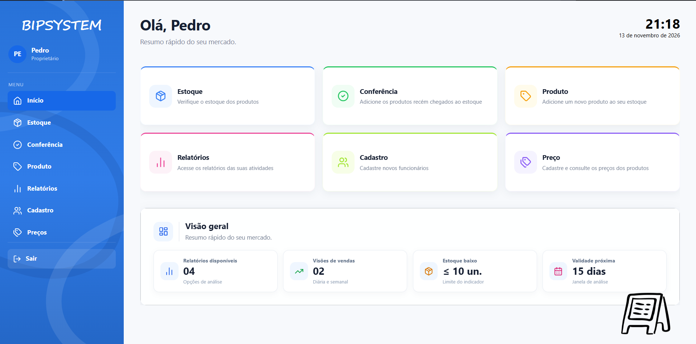
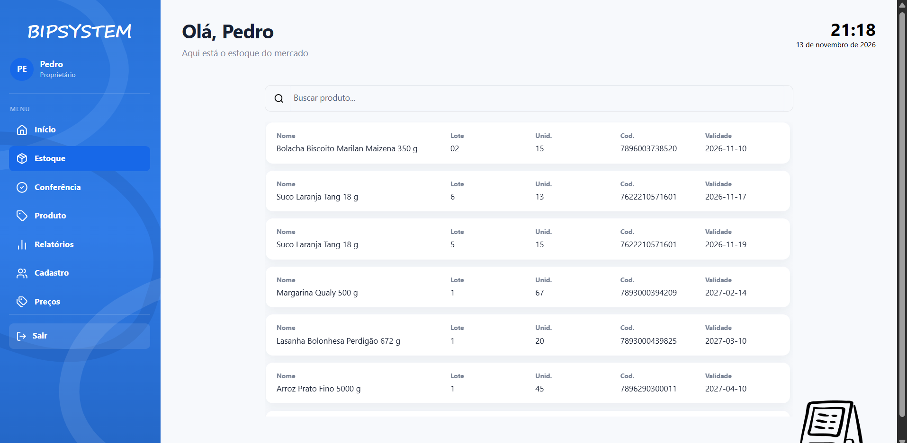
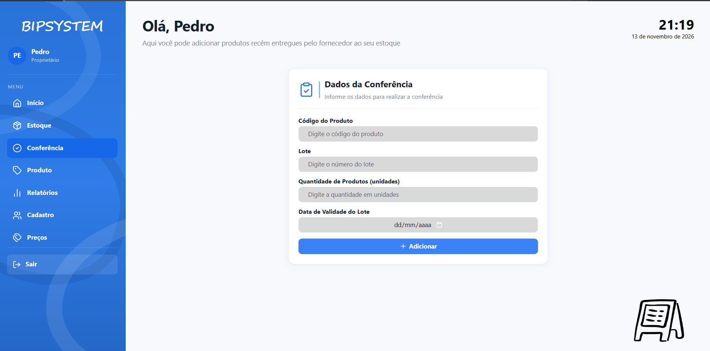
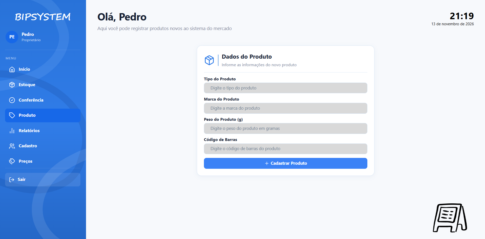
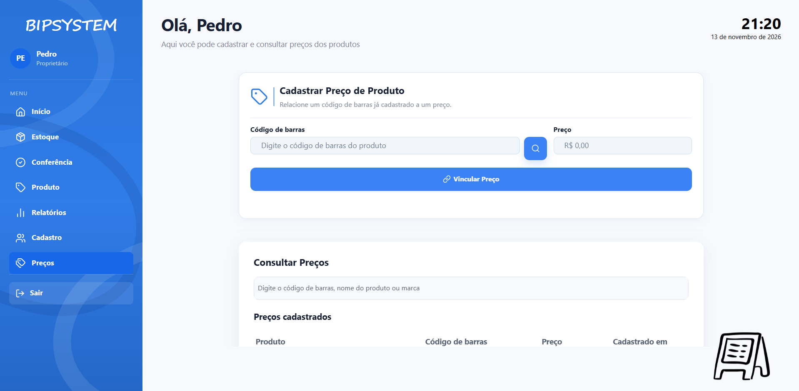
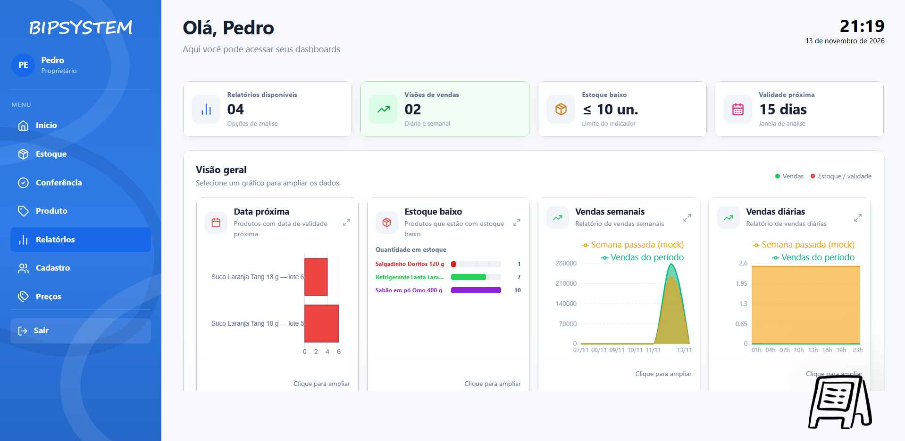
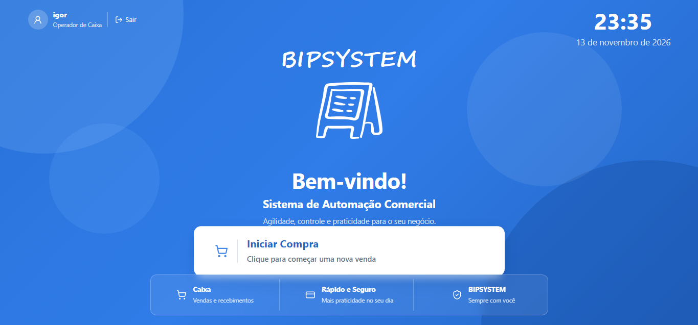
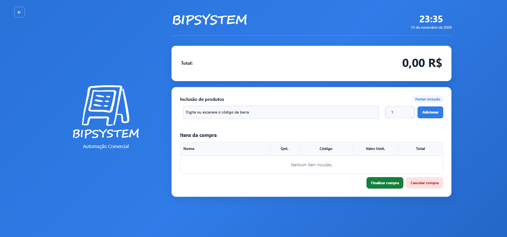
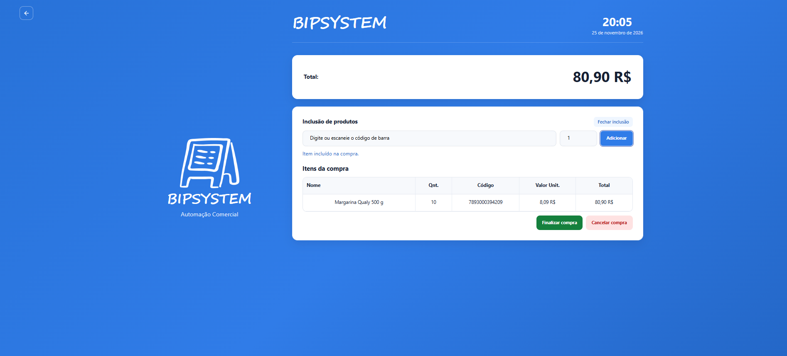
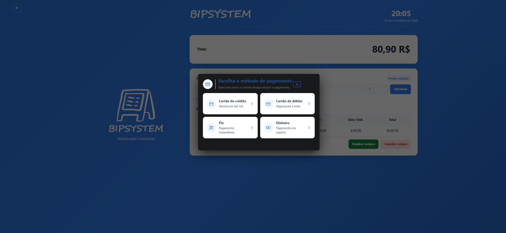

# 1. Usar — Como faço meu trabalho com o sistema? {#usar}

Quem lê: Sr. João, gestora e operadores do mercado · Referência: ISO/IEC/IEEE 26514

## 1.1 Perfis de acesso e mapa de telas {#u-perfis}

Cada funcionário entra com o próprio e-mail e senha, e o sistema mostra só as telas do seu perfil. O operador vai direto para o caixa; gerente e proprietário entram no painel de gestão.

| Perfil | Quem é no mercado | Onde cai depois do login | O que faz |
| --- | --- | --- | --- |
| Operador de caixa | Quem atende no caixa | Tela "Bem-vindo" do caixa | Registra vendas; o sistema também o autoriza a dar entrada de mercadoria e cadastrar produtos |
| Gerente | A gestora do mercado | Painel Início | Tudo o que o proprietário faz: estoque, produtos, preços, relatórios e funcionários |
| Proprietário | Sr. João | Painel Início | Todas as telas de gestão |

Gerente e proprietário não abrem o caixa: vendas são sempre registradas por um usuário com perfil de operador.

| Tela | Endereço | Para que serve | Operador | Gerente e proprietário |
| --- | --- | --- | --- | --- |
| Login | `/login` | Entrar no sistema | Sim | Sim |
| Bem-vindo do caixa | `/caixa-inicio` | Iniciar uma nova venda | Sim | Não |
| Caixa | `/caixa` | Incluir produtos, receber o pagamento, finalizar ou cancelar | Sim | Não |
| Início | `/` | Atalhos e resumo do mercado | Não | Sim |
| Estoque | `/estoque` | Ver produtos por lote, quantidade e validade | Sim | Sim |
| Conferência | `/conferencia` | Dar entrada na mercadoria entregue pelo fornecedor | Sim | Sim |
| Produto | `/produtos` | Cadastrar um produto novo | Sim | Sim |
| Relatórios | `/relatorios` | Vendas diárias e semanais, estoque baixo e validade próxima | Não | Sim |
| Cadastro | `/cadastro` | Cadastrar, editar e excluir funcionários | Não | Sim |
| Preços | `/precos` | Definir e consultar preços | Não | Sim |

## 1.2 Guia de início rápido {#u-inicio}

### Para o operador: primeira venda em 2 minutos

1. Entre com seu e-mail e senha. A tela "Bem-vindo!" aparece.
2. Clique em **Iniciar Compra**.
3. Leia o código de barras com o leitor (ou digite), ajuste a quantidade e clique em **Adicionar**. Repita para cada produto.
4. Confira o total no topo e clique em **Finalizar compra**.
5. Escolha como o cliente vai pagar: dinheiro, Pix, cartão de crédito ou cartão de débito. A mensagem "Venda concluída" confirma o registro, e o estoque já foi baixado.

### Para o gestor: deixar o mercado pronto para vender

1. Em **Cadastro**, crie um usuário para cada funcionário, com o perfil certo.
2. Em **Produto**, cadastre cada item com tipo, marca, peso e código de barras.
3. Em **Preços**, busque o código de barras e vincule o preço. Produto sem preço não pode ser vendido.
4. Em **Conferência**, dê entrada na mercadoria com lote, quantidade e validade.
5. Acompanhe em **Relatórios** as vendas, o estoque baixo e o que está perto de vencer.

## 1.3 Manual do usuário {#u-manual}

O manual segue a ordem do dia do mercado: entrar, preparar produtos e preços, receber mercadoria, vender e acompanhar os resultados.

### Entrar e sair

Na tela de login, informe e-mail e senha. Se os dados estiverem errados, aparece "E-mail ou senha inválidos". Para sair, use **Sair** no menu lateral (gestão) ou no topo da tela do caixa. A sessão é renovada sozinha; se expirar, o sistema pede novo login.

> Print pendente: tela de login.

### Painel Início (gerente e proprietário)

Mostra seis atalhos (Estoque, Conferência, Produto, Relatórios, Cadastro e Preço) e um resumo com os critérios dos indicadores: estoque baixo até 10 unidades e validade próxima em até 15 dias.

### Estoque

Lista cada lote com nome do produto, número do lote, unidades, código de barras e validade. Use "Buscar produto…" para filtrar. Um mesmo produto aparece uma vez por lote.

### Conferência: entrada de mercadoria

1. Digite o código do produto (código de barras já cadastrado).
2. Informe o número do lote, a quantidade em unidades e a data de validade.
3. Clique em **Adicionar**. A mensagem "Estoque atualizado com sucesso" confirma a entrada, e ela fica registrada no histórico de movimentações.

### Produto: cadastro de item novo

Preencha tipo, marca, peso em gramas e código de barras e clique em **Cadastrar Produto**. O nome exibido no sistema é montado com esses campos: tipo "Suco Laranja", marca "Tang" e peso 18 viram "Suco Laranja Tang 18 g". Um código de barras já usado é recusado.

### Preços

1. Em "Cadastrar Preço de Produto", digite o código de barras e clique na lupa para localizar o produto.
2. Informe o preço e clique em **Vincular Preço**.
3. Em "Consultar Preços", pesquise por código, nome ou marca. A tabela mostra o preço vigente e quando foi cadastrado.

Um novo preço não apaga o anterior: o sistema guarda todo o histórico, e vendas já feitas mantêm o preço da época.

### Relatórios

Quatro painéis, cada um ampliado com um clique: vendas diárias (por hora, hoje), vendas semanais (últimos 7 dias), estoque baixo (até 10 unidades em lotes válidos) e validade próxima (lotes que vencem nos próximos 15 dias). A série "Semana passada (mock)" ainda usa dado fictício (pendência P05).

### Cadastro de funcionários

Informe nome, e-mail, senha e função e clique em **Cadastrar Funcionário**. A senha precisa ter pelo menos 12 caracteres, com letra maiúscula, minúscula, número e símbolo. Na lista "Funcionários cadastrados", use o lápis para editar e a lixeira para excluir. Ninguém exclui a própria conta por essa tela.

> Print pendente: tela de cadastro com dados fictícios (os prints atuais mostram e-mails reais e não devem ir para o cliente).

### Caixa: registrar uma venda (operador)

1. Na tela "Bem-vindo!", clique em **Iniciar Compra**.
2. Em "Inclusão de produtos", leia ou digite o código de barras, ajuste a quantidade e clique em **Adicionar**. O item entra em "Itens da compra" com nome, quantidade, código, valor unitário e total, e o total da compra é atualizado no topo.
3. Clique em **Finalizar compra** e escolha a forma de pagamento: dinheiro, Pix, cartão de crédito ou cartão de débito.
4. O sistema confirma com "Venda concluída" e baixa o estoque, começando pelo lote que vence primeiro.
5. Para desistir, clique em **Cancelar compra** e confirme. Nada sai do estoque, e a compra cancelada fica no histórico.

> Prints pendentes: compra finalizada, compra cancelada, erro de estoque insuficiente, erro de código inválido e tela de login.

## 1.4 Perguntas frequentes {#u-faq}

| Situação ou mensagem | O que significa | O que fazer |
| --- | --- | --- |
| "E-mail ou senha inválidos" | Credenciais erradas ou usuário inativo | Confira os dados; se persistir, peça ao gerente para verificar seu cadastro |
| "Sua sessão expirou" | O acesso ficou muito tempo parado | Entre novamente; nada do que foi salvo se perde |
| "Nenhum produto encontrado para este código de barras" | O código não está cadastrado | Peça o cadastro em Produto e o preço em Preços |
| "Estoque insuficiente. Disponível: N unidades" | A quantidade pedida passa do saldo em lotes não vencidos | Reduza a quantidade; se o produto está na prateleira, peça a entrada em Conferência |
| Produto aparece no Estoque mas não sai na venda | O lote está vencido; o sistema nunca vende lote vencido | Retire o lote da prateleira e avise o gerente |
| "Já existe um produto com este código de barras" | O item já foi cadastrado | Pesquise em Preços ou Estoque em vez de cadastrar de novo |
| "Este e-mail já está cadastrado" | Já existe funcionário com esse e-mail | Edite o cadastro existente |
| Senha recusada no cadastro | Faltou um requisito | Use 12 caracteres ou mais, com maiúscula, minúscula, número e símbolo |
| "A inclusão de produtos está fechada" | O operador clicou em "Fechar inclusão" | Reabra a inclusão antes de adicionar itens |
| Gerente não encontra o caixa | O caixa é exclusivo do perfil operador | Use um usuário operador para vender |
| Preciso corrigir o saldo de um lote | A correção existe no banco, mas ainda não tem tela | Acione o suporte (aba Sustentar) |

## 1.5 Glossário de negócio {#u-glossario}

| Termo | Significado no BipSystem |
| --- | --- |
| Lote | Conjunto de unidades de um produto que chegaram juntas, com a mesma validade |
| FEFO | "Primeiro que vence, primeiro que sai": a venda consome o lote de validade mais próxima, e lote vencido nunca é vendido |
| Conferência | Entrada da mercadoria entregue pelo fornecedor, por lote e validade |
| Estoque baixo | Produto com até 10 unidades somadas nos lotes ainda válidos |
| Validade próxima | Lote com unidades disponíveis que vence entre hoje e os próximos 15 dias |
| Preço vigente | O preço cadastrado mais recente do produto |
| Total da compra | Soma de quantidade × valor unitário de cada item, calculada pelo banco em centavos para não haver arredondamento |
| Venda cancelada | Compra encerrada sem pagamento; não baixa estoque e fica registrada no histórico |
| Movimentação | Registro de cada entrada (conferência), correção ou saída (venda) de um lote |

### Exemplo de baixa por FEFO

O Suco Laranja Tang 18 g tem dois lotes: lote 6 com 13 unidades, vencendo em 17/11, e lote 5 com 15 unidades, vencendo em 19/11. Uma venda de 20 unidades consome as 13 do lote 6 e 7 do lote 5, que fica com 8.

## 1.6 Novidades da versão e treinamento {#u-novidades}

### O que esta versão traz para o dia a dia (1.0.0)

- Caixa com leitor de código de barras, quatro formas de pagamento e baixa automática do estoque.
- Tela de boas-vindas própria para o operador, que entra direto no caixa.
- Menu lateral redesenhado no painel de gestão.
- Relatórios de vendas diárias e semanais, estoque baixo e validade próxima.
- Preços com histórico: mudar um preço não altera vendas já feitas.

### Roteiro de treinamento (cerca de 1 hora)

| Parte | Público | Exercício guiado | Duração |
| --- | --- | --- | --- |
| 1 | Todos | Entrar e sair do sistema; reconhecer o seu perfil | 5 min |
| 2 | Gestão | Cadastrar um produto de teste, vincular preço e dar entrada de dois lotes com validades diferentes | 15 min |
| 3 | Operadores | Fazer uma venda com três itens e pagamento em Pix; fazer outra e cancelar | 15 min |
| 4 | Operadores | Provocar os erros de código inexistente e de estoque insuficiente e ler as mensagens | 10 min |
| 5 | Gestão | Conferir no Estoque qual lote foi baixado (FEFO) e ler os quatro relatórios | 10 min |
| 6 | Todos | Perguntas, registradas para o FAQ | 5 min |

A sessão deve ser gravada; a gravação e as perguntas atendem ao critério de transferência de conhecimento.
