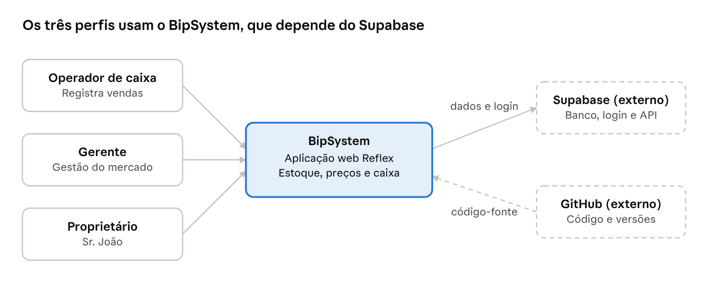
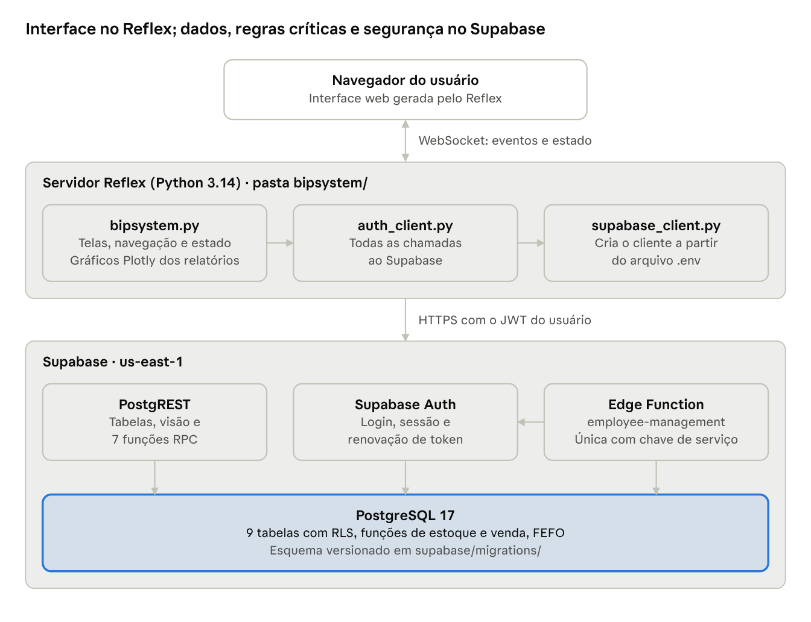
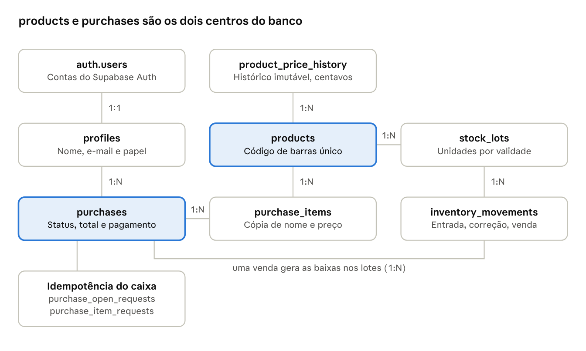

# 2. Manter — Como o sistema funciona e por que foi feito assim? {#manter}

Quem lê: desenvolvedores · Referência: ISO/IEC/IEEE 42010

## 2.1 Requisitos e regras de negócio {#m-requisitos}

Cada requisito aponta para onde está implementado e para o teste que o verifica, para que uma mudança saiba o que precisa ser retestado.

### Requisitos funcionais

| ID | O sistema deve… | Implementação | Teste |
| --- | --- | --- | --- |
| RF01 | Autenticar por e-mail e senha, renovar a sessão e encerrar no logout | `auth_client.login`, `refresh_session`, `logout` | `test_auth_client.py`, `test_auth_session.py` |
| RF02 | Levar cada perfil à sua área e barrar telas não permitidas | `AuthState.require_*` em `bipsystem.py` | `test_auth_session.py`, `test_cashier_welcome.py` |
| RF03 | Listar, criar, editar e excluir funcionários | Edge Function `employee-management`; `auth_client.*_employee` | `test_employee_card.py`, `test_employee_delete.py`, `test_registration_feedback.py`, `employee_policy_test.ts` |
| RF04 | Cadastrar produto com tipo, marca, peso e código de barras único | `auth_client.create_product`; tabela `products` | `test_products.py`, `test_product_card.py` |
| RF05 | Dar entrada de mercadoria por lote e validade | RPC `receive_stock`; `auth_client.create_inventory_lot` | `test_conference_card.py` |
| RF06 | Listar o estoque por lote | `auth_client.list_inventory`; tabela `stock_lots` | `test_auth_client.py` |
| RF07 | Vincular preço e consultar o preço vigente | `create_product_price`, `list_current_prices`; visão `current_product_prices` | `test_prices.py`, `test_price_card.py` |
| RF08 | Abrir compra, incluir itens, finalizar com pagamento ou cancelar | RPCs `open_`, `add_`, `get_`, `complete_` e `cancel_cashier_purchase` | `test_cashier_sales.py` |
| RF09 | Exibir vendas diárias e semanais, estoque baixo e validade próxima | `SalesDashboardState`, `EstoqueState`, `ValidadeState` | `test_sales_dashboard.py` |
| RF10 | Navegar pelo menu lateral de gestão | Componentes de sidebar em `bipsystem.py` | `test_sidebar.py` |

### Regras de negócio

| ID | Regra | Onde é garantida |
| --- | --- | --- |
| RN01 | Código de barras é único | Índice único `products_barcode_unique_idx` |
| RN02 | Cada produto tem no máximo um lote por data de validade; uma nova entrada com a mesma validade soma unidades ao lote existente e mantém o número de lote original | Índice único `(product_id, expires_on)` e `receive_stock` |
| RN03 | A venda consome primeiro o lote que vence antes (FEFO) e nunca usa lote vencido | `complete_cashier_purchase` (migração `cashier_expiry_fefo`) |
| RN04 | Sem saldo suficiente em lotes válidos, a venda inteira é recusada e nada é baixado | `complete_cashier_purchase`, erro `P1010` |
| RN05 | Toda entrada, correção e venda gera uma movimentação; uma venda baixa cada lote uma única vez | `inventory_movements` e índice único `(purchase_id, stock_lot_id)` para vendas |
| RN06 | Preços são maiores que zero, guardados em centavos e nunca alterados ou apagados | `CHECK price_cents > 0`; RLS sem UPDATE nem DELETE |
| RN07 | O item vendido guarda cópia do nome, código e preço do produto no momento da venda | Colunas de `purchase_items` |
| RN08 | Cada operador tem no máximo uma compra aberta por vez | Índice único parcial `purchases_one_open_per_user_idx` |
| RN09 | Pagamento aceito: dinheiro, Pix, cartão de crédito e débito | `CHECK` em `purchases.payment_method` |
| RN10 | Repetir a abertura de compra ou a inclusão de item não duplica nada (idempotência) | Tabelas `purchase_open_requests` e `purchase_item_requests` |
| RN11 | Correção de estoque exige gerente ou proprietário e um motivo | `correct_stock` |
| RN12 | Senha de funcionário: mínimo de 12 caracteres, com maiúscula, minúscula, número e símbolo | `employee_policy.ts` |
| RN13 | Ninguém exclui a própria conta pela tela de cadastro | `assertCanManageEmployee` |

## 2.2 Arquitetura (modelo C4) {#m-arquitetura}

O BipSystem é uma aplicação Reflex em Python que usa o Supabase como banco, autenticação e API. As regras que mexem em estoque e dinheiro rodam dentro do PostgreSQL, e a única peça com credencial administrativa é a Edge Function de funcionários.

### Nível 1 — Contexto

Os três perfis do mercado usam o BipSystem pelo navegador. O sistema depende de um serviço externo, o Supabase (nuvem, região us-east-1), e o código-fonte fica no GitHub.



### Nível 2 — Contêineres e nível 3 — Componentes

| Contêiner | Tecnologia | Responsabilidade |
| --- | --- | --- |
| Interface web | React gerado pelo Reflex, no navegador | Telas; conversa com o servidor Reflex por WebSocket |
| Servidor Reflex | Python 3.14, Reflex 0.8.28.post1 | Estado, eventos, regras de navegação por perfil e chamadas ao Supabase |
| Supabase Auth | Serviço gerenciado | Login, tokens JWT e renovação de sessão |
| PostgREST | Serviço gerenciado | API REST das tabelas, visões e funções RPC, sempre com o JWT do usuário |
| Edge Function `employee-management` | Deno/TypeScript | Administra contas de funcionários com a chave de serviço |
| PostgreSQL 17 | Banco gerenciado | Tabelas, RLS, funções de estoque e venda |

Dentro do servidor Reflex, `bipsystem/bipsystem.py` concentra telas e estado, `bipsystem/auth_client.py` faz todas as chamadas ao Supabase e `bipsystem/supabase_client.py` cria o cliente a partir das variáveis de ambiente.



## 2.3 Registros de decisão de arquitetura (ADRs) {#m-adrs}

As decisões abaixo estão aceitas e implementadas. O texto completo de cada uma está em `openspec/changes/*/design.md`.

| ADR | Decisão | Por quê | Alternativa descartada | Consequência |
| --- | --- | --- | --- | --- |
| 001 | Interface e estado em Python com Reflex | A equipe trabalha numa só linguagem | Front-end JavaScript separado | Interface e estado concentrados em um arquivo grande (dívida técnica) |
| 002 | Trocar o Xano pelo Supabase | Banco relacional versionado por migrações, RLS e autenticação integrada | Manter o Xano | O sistema começou do zero no Supabase, sem importar dados do Xano (P06) |
| 003 | Chamar o Supabase pelo cliente Python no servidor Reflex, com o JWT do usuário | Mantém o token fora do navegador e respeita o RLS | supabase-js no navegador; acesso SQL direto | Toda chamada passa por `auth_client.py` |
| 004 | Contas de funcionários numa única Edge Function | A administração de usuários exige a chave de serviço, que não pode sair do servidor | Chave de serviço no app | Função valida o JWT e lê o papel em `profiles`, nunca do corpo da requisição |
| 005 | Estoque e venda alterados só por funções SQL `SECURITY DEFINER` que conferem o papel | Uma transação única, sem perda em acessos simultâneos | Atualizar tabelas direto do app | O Supabase sinaliza essas funções como executáveis por usuários logados; é intencional |
| 006 | Gerente e proprietário têm as mesmas permissões sobre funcionários, incluindo atribuir qualquer papel | Matriz de papéis aprovada no projeto | Restringir o papel de proprietário ao próprio proprietário | Um gerente pode promover alguém a proprietário; o cliente deve confirmar (P02) |
| 007 | Dinheiro em centavos (inteiros) | Somas exatas | Decimais em ponto flutuante | Conversão para reais só na tela |
| 008 | Preço como histórico imutável e cópia do preço no item vendido | Auditoria e vendas passadas estáveis | Atualizar o preço no lugar | Preço vigente vem da visão `current_product_prices` |
| 009 | Idempotência por identificador de requisição no caixa | Clique duplo ou rede instável não duplicam venda | Confiar no cliente | Duas tabelas auxiliares fechadas ao acesso direto |
| 010 | Mesma validade do mesmo produto vira um único lote | Comportamento herdado, mantido na migração | Um lote por rótulo | O número de lote informado depois é ignorado; revisar no futuro |

## 2.4 Modelo e dicionário de dados {#m-dados}

O esquema `public` tem 9 tabelas, todas com RLS, e uma visão. A fonte oficial são as migrações em `supabase/migrations/`; o dicionário abaixo foi conferido contra o banco em produção em 25/11/2026.



Além das ligações desenhadas, quase todas as tabelas registram quem criou cada linha (`created_by`, ligado a `profiles`); essas ligações foram omitidas para manter o diagrama legível.

### Dicionário

| Tabela | Colunas (tipo) | Chaves e restrições | Linhas |
| --- | --- | --- | --- |
| `profiles` | `id` uuid, `email` text, `name` text, `role` app_role (operator, manager, owner; padrão operator), `is_active` bool, `created_at`, `updated_at` | PK e FK para `auth.users`; e-mail único e em minúsculas; nome não vazio | 11 |
| `products` | `id` uuid, `product_type` text, `brand` text, `weight_grams` numeric, `barcode` text, `is_active` bool, `created_by` uuid, `created_at`, `updated_at` | Código de barras único e sem espaços; peso maior que zero; não há coluna de nome: o nome exibido é tipo + marca + peso | 28 |
| `stock_lots` | `id` uuid, `product_id` uuid, `batch_label` text, `units` int, `expires_on` date, `created_by`, `created_at`, `updated_at` | Único por produto e validade; unidades maiores ou iguais a zero | 31 |
| `inventory_movements` | `id` uuid, `stock_lot_id` uuid, `units_delta` int, `movement_type` text (receipt, correction, sale), `reason` text, `purchase_id` uuid, `created_by`, `created_at` | Variação diferente de zero; uma baixa por lote por venda | 41 |
| `product_price_history` | `id` uuid, `product_id` uuid, `price_cents` bigint, `created_by`, `created_at` | Preço maior que zero; somente inclusão | 19 |
| `purchases` | `id` uuid, `created_by` uuid, `status` text (open, completed, cancelled), `total_cents` bigint, `payment_method` text (cash, pix, credit_card, debit_card), `created_at`, `closed_at` | Uma compra aberta por operador; total maior ou igual a zero | 17 |
| `purchase_items` | `id` uuid, `purchase_id`, `product_id`, `product_name` text, `barcode` text, `quantity` int, `unit_price_cents` bigint, `line_total_cents` bigint, `created_at` | Único por compra, produto e preço; quantidade e preço maiores que zero | 17 |
| `purchase_open_requests` | `request_id` uuid, `purchase_id`, `created_by`, `created_at` | Idempotência da abertura; sem acesso direto | 25 |
| `purchase_item_requests` | `request_id` uuid, `purchase_id`, `barcode` text, `quantity` int, `created_at` | Idempotência da inclusão de item; sem acesso direto | 21 |
| `current_product_prices` (visão) | Produto, nome montado, código de barras e preço mais recente | Respeita o RLS de quem consulta | — |

### Origem e linhagem dos dados

| Dado | Nasce em | Passa por | Vira |
| --- | --- | --- | --- |
| Funcionário | Tela Cadastro | Edge Function → Supabase Auth → gatilho `sync_auth_profile` | Linha em `profiles` |
| Produto | Tela Produto | `products` | Item vendável quando tem preço e estoque |
| Preço | Tela Preços | `product_price_history` | Preço vigente na visão e cópia em `purchase_items` |
| Entrada de mercadoria | Tela Conferência | `receive_stock` | Lote em `stock_lots` e movimentação `receipt` |
| Venda | Tela Caixa | `purchases` e `purchase_items` → `complete_cashier_purchase` | Baixa nos lotes, movimentações `sale` e dados dos relatórios |
| Dados históricos do Xano | Plataforma antiga | Exportação validada por `scripts/validate_xano_export.py` | Não importados, por decisão de começar do zero (P06) |

## 2.5 Contratos de API {#m-api}

O app usa duas interfaces: funções RPC do PostgREST para estoque e caixa, e a Edge Function para funcionários. Toda chamada leva o JWT do usuário no cabeçalho `Authorization: Bearer`. O PostgREST também publica a especificação OpenAPI de todas as tabelas e funções na raiz `/rest/v1/` do projeto.

### Funções RPC (`POST /rest/v1/rpc/<nome>`)

| Função | Parâmetros | Retorna | Quem pode |
| --- | --- | --- | --- |
| `receive_stock` | `p_product_id` uuid, `p_batch_label` text, `p_units` int, `p_expires_on` date | Lote atualizado | Todos os perfis |
| `correct_stock` | `p_stock_lot_id` uuid, `p_units_delta` int, `p_reason` text | Lote atualizado | Gerente e proprietário |
| `open_cashier_purchase` | `p_open_request_id` uuid | Compra aberta com itens | Usuário ativo |
| `add_cashier_purchase_item` | `p_purchase_id` uuid, `p_barcode` text, `p_quantity` int, `p_request_id` uuid | Compra atualizada | Dono da compra |
| `get_cashier_purchase` | `p_purchase_id` uuid | Compra com itens e total | Dono da compra |
| `complete_cashier_purchase` | `p_purchase_id` uuid, `p_payment_method` text | Compra concluída | Dono da compra |
| `cancel_cashier_purchase` | `p_purchase_id` uuid | Compra cancelada | Dono da compra |

### Códigos de erro do caixa

| Código | Significado |
| --- | --- |
| `42501` | Usuário sem permissão |
| `P1001` | Código de barras não pertence a produto ativo |
| `P1002` | Produto sem preço vigente |
| `P1003` | Compra não está aberta |
| `P1004` | Compra não encontrada |
| `P1005` | Compra sem itens |
| `P1006` | Quantidade inválida |
| `P1007` | Identificador de requisição reutilizado com outros dados |
| `P1010` | Estoque insuficiente |
| `P1011` | Compra já finalizada com outra forma de pagamento |

### Edge Function `employee-management`

`POST /functions/v1/employee-management`, com JWT obrigatório. Só gerente e proprietário ativos são atendidos.

| `action` | Corpo | Resposta de sucesso |
| --- | --- | --- |
| `list` | — | 200 `{ employees: [{ id, name, email, role, is_active, created_at }] }` |
| `create` | `name`, `email`, `password`, `role` | 201 `{ employee: { id, name, email, role, is_active } }` |
| `update` | `userId`, `name`, `email`, `role`, `password` opcional | 200 `{ employee: {…} }` |
| `delete` | `userId` | 200 `{ deleted: true, userId }` |

Erros voltam como `{ error: "mensagem" }` com status 400 (dado inválido), 401 (sem sessão), 403 (sem permissão) ou 5xx (falha no Supabase).

## 2.6 Guia de desenvolvimento e testes {#m-dev}

Com Python 3.14 e as duas variáveis do Supabase, o sistema sobe localmente em poucos minutos. O Python 3.15 não é compatível com o Reflex 0.8.28.post1.

### Ambiente local (Windows, PowerShell)

```powershell
git clone https://github.com/MercadinhoSoluts/Solu-ao-mercadinho.git
cd Solu-ao-mercadinho
py -3.14 -m venv .venv
.\.venv\Scripts\Activate.ps1
python -m pip install -r requirements.txt
Copy-Item .env.example .env   # preencha SUPABASE_URL e SUPABASE_ANON_KEY
reflex run                    # interface em http://localhost:3000
```

Evite manter o projeto dentro do OneDrive: a sincronização deixa o Reflex lento e pode travar a troca de branches no Git.

### Variáveis de ambiente

| Variável | Onde fica | Uso |
| --- | --- | --- |
| `SUPABASE_URL` | `.env` do app | Endereço do projeto Supabase |
| `SUPABASE_ANON_KEY` | `.env` do app | Chave pública; o acesso real é limitado pelo RLS |
| `SUPABASE_SERVICE_ROLE_KEY` | Segredos da Edge Function, nunca no app | Administração de contas |
| `INITIAL_OWNER_BOOTSTRAP_SECRET` | Segredos da Edge Function | Criação do primeiro proprietário |

### Testes

```powershell
python -m unittest discover -s tests -v          # 16 arquivos: app e integração
deno test supabase/functions/employee-management # política de funcionários
```

### Padrões da equipe

- Toda mudança começa como proposta no OpenSpec (`openspec/changes/<nome>/`: proposta, design, especificação e tarefas) e só é arquivada quando todas as tarefas estão concluídas.
- Mudança de banco é sempre uma nova migração `AAAAMMDDHHMMSS_descricao.sql`; migração já aplicada nunca é editada.
- Toda tabela nova nasce com RLS e políticas; alteração de saldo só por função SQL.
- Valores em dinheiro sempre em centavos; textos da interface em português.
- Chamadas ao Supabase ficam em `auth_client.py`, nunca espalhadas pelas telas.
- Trabalho novo em branch própria, integrado à `main` só com os testes passando.
